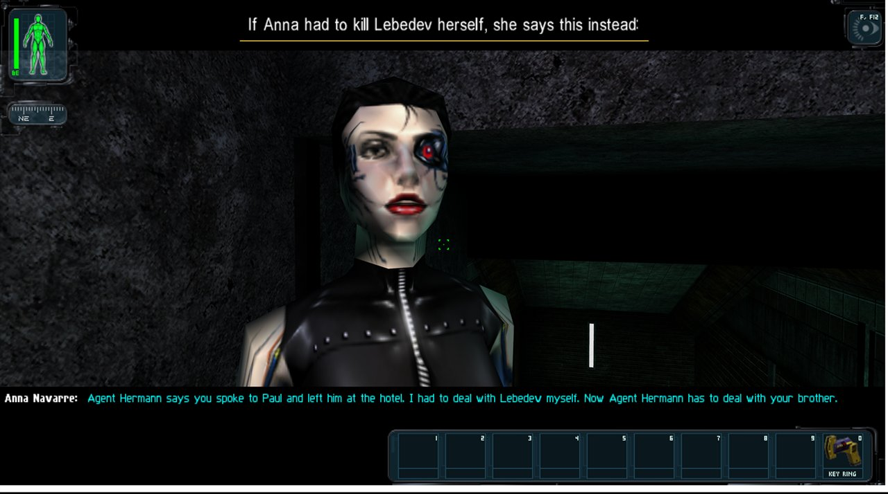
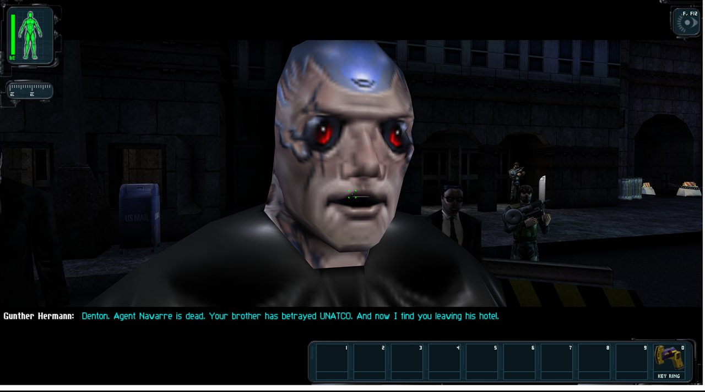
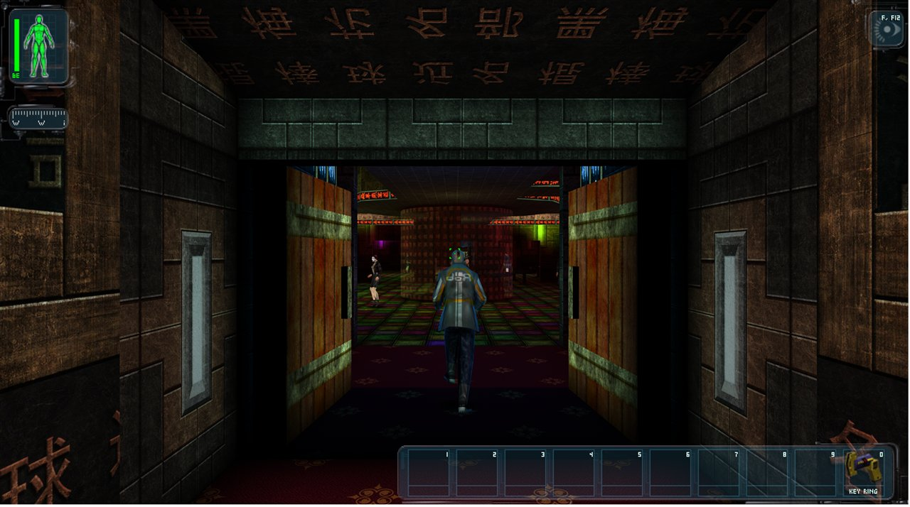
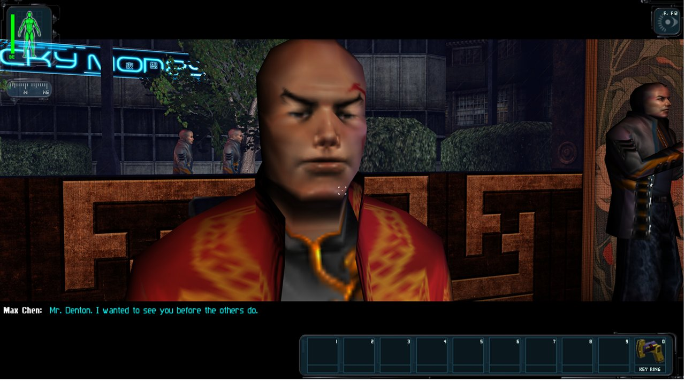
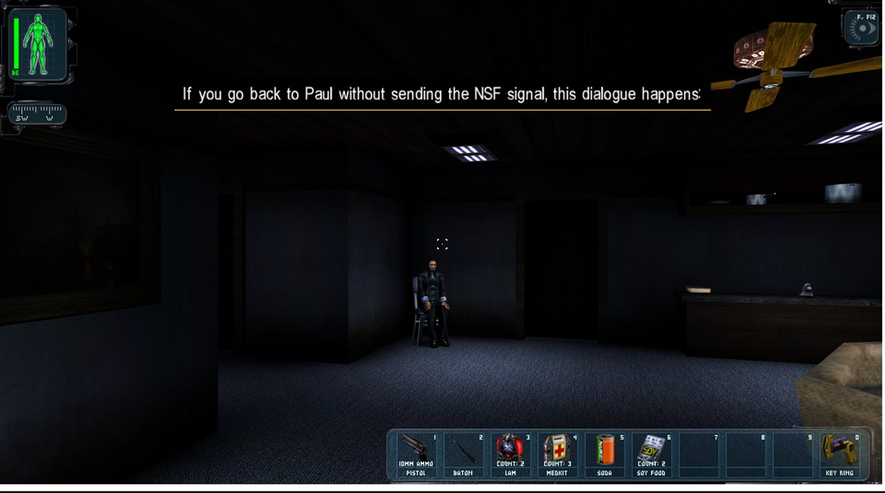

# UNATCO Continues

**A story mod for Deus Ex, for both the original game (Game of the Year Edition) and
[Deus Ex: Revision](https://store.steampowered.com/app/397550/Deus_Ex_Revision/).
What if JC Denton had said no to his brother, and stayed with UNATCO?**

> **Work in progress.** The new route is playable from mission 4 to Hong Kong, and is still
> being built. Follow it and talk about it on [Discord](https://discord.gg/GRNcZf8PM).

**[▶ Watch the demo of the mod on YouTube](https://www.youtube.com/watch?v=U4Ep9GD3eVY)**

[](https://www.youtube.com/watch?v=U4Ep9GD3eVY)

In the original game JC leaves UNATCO in mission 4 whatever the player does. This mod
makes that moment a real choice. Refuse Paul at the 'Ton hotel and the story goes on from
there: Gunther arrives for your brother, Anna Navarre watches the subway, Jock flies you to
Hong Kong as a UNATCO agent, a Special Projects liaison meets you on a civilian rooftop, the Triads treat you as the
law, and Tracer Tong is no longer your rescuer. He is your assignment.



## What this repository is for

It is the complete working repository of the mod, **open source (MIT)**, published so that
anyone can read it, build it and continue it:

- **the story**, as a [narrative design document](docs/NARRATIVE_DESIGN.md) with every
  line of dialogue the mod adds, its conditions and its variants;
- **how it was made**: the [workflow](docs/WORKFLOW.md), built around the DeusEdix map editor,
  and the tools written along the way;
- **tutorials** for the techniques that are reusable in other Deus Ex mods;
- **the source**: UnrealScript, build scripts and tools.

## Download and play

There are two versions, for two games. Each has its own installer: it finds your game, makes the
mod's maps from your own copy of the game and adds a console command to start the mod.
Uninstall it from Windows' *Installed apps*.

| Your game | Installer |
|---|---|
| **Deus Ex** (the original, Game of the Year Edition) | `UNATCO-Continues-DeusEx-Setup` on the [Releases page](https://github.com/Gabby16Bitbox/unatco-continues/releases) |
| **Deus Ex: Revision** | `UNATCO-Continues-Revision-Setup` on the [Releases page](https://github.com/Gabby16Bitbox/unatco-continues/releases) |

Then start the game, load or begin a game, open the console (**T**, delete `Say`) and type
`exec unatcostart.txt` (original game) or `unatcostart` (Revision). Details, the jump menu and
manual installation: [PLAY.md](PLAY.md).

Windows may say *"Windows protected your PC"*: the installers are not signed. Click
*More info*, then *Run anyway*.

**No voices are included.** The mod's new lines appear as subtitles. You can make the voices
yourself: see [docs/VOICES.md](docs/VOICES.md).

## Made with DeusEdix

The mod's maps, scenes, dialogues and InfoLinks are made with **DeusEdix**, a map and story editor for
Deus Ex and Deus Ex: Revision that works in the browser, without UnrealEd. DeusEdix is a separate
project: *coming soon*.

## Wanted: help to finish it

We are looking for passionate people who would like to finish the project:

- **mappers**, to build the levels still to come;
- **story writers**, to improve the [mission scripts](docs/MISSION_SCRIPTS.md) (marked *to be
  improved*) and write what comes next;
- **game dev generalists**: UnrealScript, scenes, conversations, testing.

News on the YouTube channel **GABROCHACHO** ([the demo of the mod](https://www.youtube.com/watch?v=U4Ep9GD3eVY)). Discord: [https://discord.gg/GRNcZf8PM](https://discord.gg/GRNcZf8PM).

**Want to continue it?** Start with [CONTRIBUTING.md](CONTRIBUTING.md),
[what works and what is next](docs/STATUS.md), and the
[concept for the rest of the campaign](docs/CAMPAIGN_CONCEPT.md).

## Status

Work in progress. The finished part goes from the fork at the 'Ton hotel (mission 4) to Hong Kong,
and **ends when you step out of the butcher's shop onto Wan Chai Street**, after the Harbourline
garage. Everything after that (the market, Maggie Chow, Gordon Quick, Tracer Tong) is still being
built: unfinished, and parts of it behave at random.

To get anywhere fast, press **Home** in the game: a menu jumps to each part of the story
([the jump menu](PLAY.md#the-jump-menu-home-key)).

The [new Hong Kong arrival](docs/HONGKONG_ROOFTOP_FLOW.md) connects a small raised helipad
to a Wan Chai service yard by freight lift. A raid targets a secured shipment;
intervening, reading the cargo label and following the Red Arrow lead are separate choices.

## What is in the repository

| Path | What |
|---|---|
| `src/UnatcoContinues/Classes` | the mod's code (UnrealScript) |
| `docs/NARRATIVE_DESIGN.md` | premise, writing rules, the full script |
| `docs/WORKFLOW.md` | who does what, the working loop, the tools |
| `docs/tutorials/` | step-by-step guides |
| `docs/*.md` in Italian | the working notes: designs, plans, playtest checklist |
| `tools/` | scripts: game-data readers, map tools, automatic in-game photos, checks |
| `maps/` | the mod's changes to the maps as patches: `maps/patches` for Revision, `maps/vanilla/patches` for the original game (no map is shipped) |
| `installer/`, `tools/build_installers.py` | the two installers (Inno Setup) |
| `build.ps1`, `install.ps1`, ... | build and install scripts (Windows, PowerShell) |

**Not included, on purpose:**

- any game file: no file of Deus Ex or Revision is included. The maps are patches that are
  applied to your own copy of the game, and the mod needs the original game to run. It is free
  and not for sale (see [NOTICE.md](NOTICE.md));
- the voice recordings, the samples and the voice identifiers. Every line is in the script
  as text; in game, a line without a recording is shown as a subtitle;

## Voices

The mod's lines are written in the script and shown as subtitles; no recording is shipped, and the
voice tools are not published. How voices could be made, if you want them: [docs/VOICES.md](docs/VOICES.md).

## Requirements

- Deus Ex: Game of the Year Edition, and Deus Ex: Revision for the Revision version (Steam).
- To build: the Deus Ex SDK installer, 7-Zip and Python 3, as described in
  [tutorial 1](docs/tutorials/01-setup-build-install.md).

## Quick start

To play: [PLAY.md](PLAY.md). To build it yourself (keep the project in a **short folder
path**, such as `C:\Dev\unatco-continues`: the 2000-era compiler crashes on long paths):

```powershell
.\setup.ps1              # development copy of the game
.\build.ps1 -Isolated    # compile
.\install.ps1            # game closed
```

Then, in the game, type `unatcostart` in the console once to start the mod, or `unatco` for the
debug menu that jumps straight to a scene.

## Narrative rewrite in progress

The [6 October rewrite](docs/CAMPAIGN_REWRITE_2026_10_06.md) revises Gunther and Hong Kong: competing Triad offers, evidence with readable provenance, and an assault caused by the player opening Special Projects' access. It is a script and mission design awaiting implementation; the playable build and source-derived narrative document still describe the previous version.

## Documentation

1. [Narrative design document](docs/NARRATIVE_DESIGN.md) - start here for the story.
   The [mission scripts](docs/MISSION_SCRIPTS.md) of Battery Park and the Hong Kong opening, as
   written before building them (to be improved).
2. [Campaign concept](docs/CAMPAIGN_CONCEPT.md) - where the story could go next:
   VersaLife, the return to New York, Vandenberg, the endings.
3. [Continuing the mod](CONTRIBUTING.md) and [status](docs/STATUS.md)
4. [Workflow and tools](docs/WORKFLOW.md)
5. Tutorials
   - [Setup, build, install](docs/tutorials/01-setup-build-install.md)
   - [Writing a conversation in code](docs/tutorials/02-conversations-in-code.md)
   - [Scenes, flags and the rules of the conversation engine](docs/tutorials/03-scenes-and-flags.md)
   - [Automatic in-game photos](docs/tutorials/04-automatic-photos.md)
   - [Reading maps and game data without the editor](docs/tutorials/05-reading-game-data.md)
   - [The presentation mode used for the video](docs/tutorials/06-presentation-mode.md)
   - [The map editor: maps, properties, dialogues, InfoLinks and events without UnrealEd](docs/tutorials/07-map-editor.md)

## Screenshots

| | |
|---|---|
|  |  |
|  |  |

## Credits and notice

Made by Gabby ([@Gabby16Bitbox](https://github.com/Gabby16Bitbox)) with the DeusEdix map editor
(see the [workflow](docs/WORKFLOW.md)).

This is an unofficial fan project. Deus Ex is a trademark of its owners; Deus Ex: Revision
is the work of Caustic Creative. No game files are included: the maps are patches applied to
your own copy of Deus Ex, and the mod needs the original game to run. Free, not for sale.

[Discord](https://discord.gg/GRNcZf8PM) · DeusEdix: *coming soon*

## Licence

[MIT](LICENSE) for everything written for this project: code, tools, documentation and
dialogue. What the licence does not cover is listed in [NOTICE.md](NOTICE.md).
